# WebRTC Knowledge Base

> **WebRTC (Web Real-Time Communication)** is a free, open-source project that gives browsers and mobile apps real-time communication through simple APIs. It lets peers share **audio, video, and arbitrary data** directly with each other, with no plugins or third-party software.

## Table of Contents

1. [The Big Picture](#1-the-big-picture)
2. [NAT: Why Connecting Is Hard](#2-nat-why-connecting-is-hard)
3. [STUN: "What Is My Public Address?"](#3-stun-what-is-my-public-address)
4. [TURN: The Relay Fallback](#4-turn-the-relay-fallback)
5. [ICE: Finding the Best Path](#5-ice-finding-the-best-path)
6. [SDP: Describing the Session](#6-sdp-describing-the-session)
7. [Signaling: Exchanging the SDP](#7-signaling-exchanging-the-sdp)
8. [Putting It All Together](#8-putting-it-all-together)
9. [Security](#9-security)
10. [Use Cases, Limitations & Alternatives](#10-use-cases-limitations--alternatives)
11. [Glossary](#11-glossary)

--- 

## 1. The Big Picture

Before two peers can talk directly, they have to solve three problems:

| Problem | Solved by |
| --- | --- |
| **How do we find each other and swap info?** | Signaling (your own server: WebSocket, HTTP, …) |
| **What network path can reach the other peer?** | ICE, using STUN and TURN servers |
| **What media can we both send and understand?** | SDP (offer / answer) |

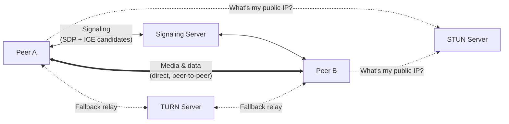

> The signaling server only helps the peers **set up** the call. Once connected, media flows **directly** between peers, or through TURN if a direct path is impossible.

---

## 2. NAT: Why Connecting Is Hard

**NAT (Network Address Translation)** remaps one IP address space into another by rewriting the address information in packet headers as they pass through a router.

Your device usually has a **private** IP (e.g. `192.168.1.10`). The rest of the internet only ever sees your router's **public** IP. A remote peer can't reach a private address, which is the core problem WebRTC has to work around.

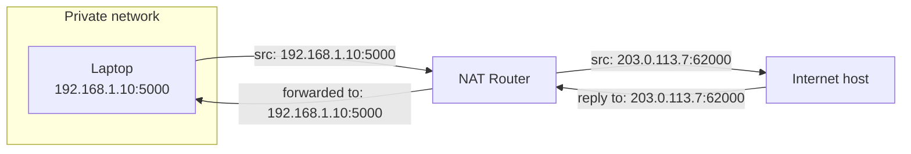

### NAT Types

NATs differ in **how they map ports** and in **who is allowed to send packets back in**:

| NAT type | Mapping | Who can send packets in | P2P difficulty |
| --- | --- | --- | --- |
| **Full Cone** (one-to-one) | Same public `IP:port` for every destination | **Anyone** who knows the mapping | 🟢 Easy |
| **Address-Restricted Cone** | Same public `IP:port` for every destination | Only **IPs** the client has already sent to | 🟢 Easy with STUN |
| **Port-Restricted Cone** | Same public `IP:port` for every destination | Only **IP:port pairs** the client has already sent to | 🟡 Usually works with STUN |
| **Symmetric** | A **new** public `IP:port` for **each destination** | Only the exact destination it was created for | 🔴 Usually needs TURN |

#### Why symmetric NAT breaks STUN

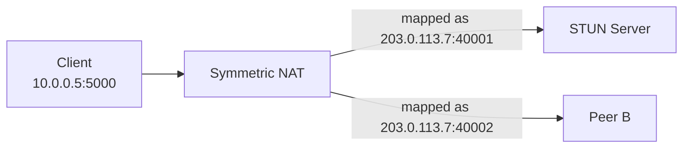

The STUN server reports `:40001`, but traffic to Peer B goes out through a **different** port (`:40002`). The address the client advertised is wrong for Peer B, so the direct connection fails and a TURN relay is needed.

---

## 3. STUN: "What Is My Public Address?"

**STUN (Session Traversal Utilities for NAT)** lets a client detect that it is behind a NAT and learn the **public IP and port** the NAT assigned to it.

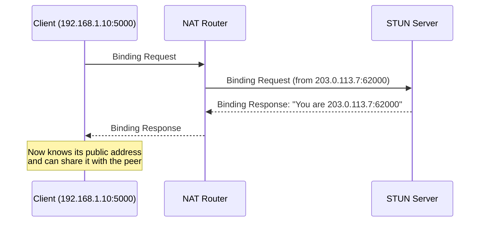

| | |
| --- | --- |
| **Default ports** | `3478` (UDP/TCP), `5349` (TLS) |
| **Cost** | 💰 Cheap: it only answers small requests and never carries media |

---

## 4. TURN: The Relay Fallback

**TURN (Traversal Using Relays around NAT)** is used when a direct connection is impossible (e.g. symmetric NAT or strict firewalls). Both peers send all their traffic **through** the TURN server, which relays it to the other side.

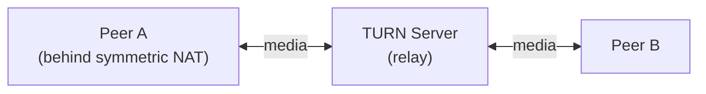

| | |
| --- | --- |
| **Default ports** | `3478` (UDP/TCP), `5349` (TLS) |
| **Cost** | 💰💰💰 Expensive: **every byte** of audio and video passes through it |

### STUN vs TURN at a glance

| | STUN | TURN |
| --- | --- | --- |
| Purpose | Discover your public address | Relay traffic between peers |
| Carries media? | ❌ No | ✅ Yes |
| Bandwidth cost | Tiny | High |
| When it's used | Almost always | Only when a direct path fails |

---

## 5. ICE: Finding the Best Path

**ICE (Interactive Connectivity Establishment)** is the framework that figures out **how** two peers can reach each other, even behind NATs and firewalls. It uses STUN and TURN to collect possible addresses, then tests them.

### ICE candidates

A **candidate** is one possible network address (`IP:port` + protocol) that a peer could be reached on.

| Candidate type | Where it comes from | Example | Preference |
| --- | --- | --- | --- |
| **host** | The device's own network interfaces | `192.168.1.10:5000` | 1st (fastest, same LAN) |
| **srflx** (server reflexive) | Public address discovered via **STUN** | `203.0.113.7:62000` | 2nd |
| **relay** | Address allocated on a **TURN** server | `198.51.100.20:49152` | 3rd (last resort) |

### The three ICE steps

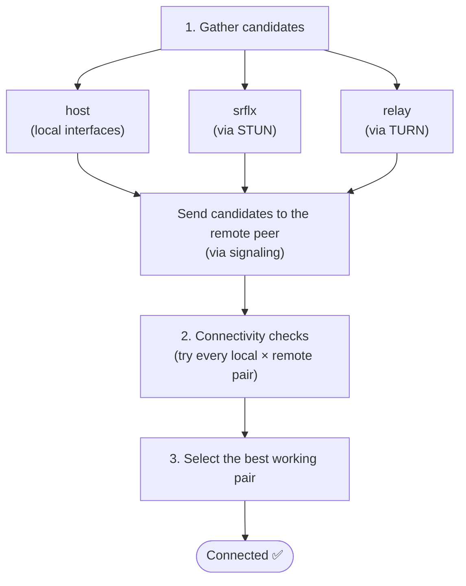

### Which path wins?

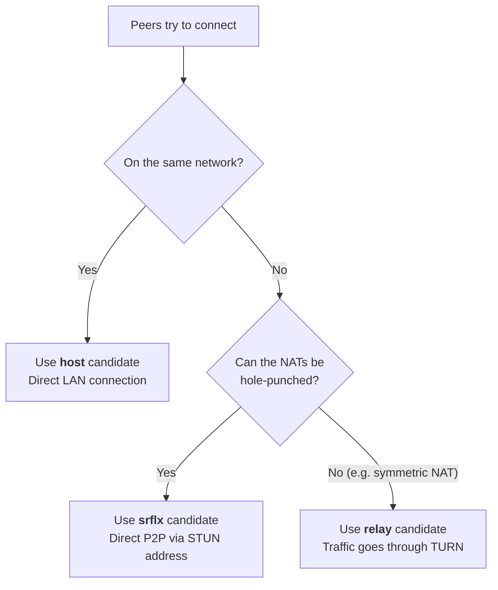

> **Trickle ICE:** Candidates can be bundled into the SDP, but browsers usually send them **one by one as they are discovered** (`onicecandidate`). This speeds up connection setup.

---

## 6. SDP: Describing the Session

**SDP (Session Description Protocol)** describes a multimedia session: which **media types**, **codecs**, **transport protocols**, ICE credentials, and security fingerprints a client supports.

- Despite the name, it's **not really a protocol**. It's a **text format**.
- It's used alongside other protocols such as **SIP** and **ICE**.
- It's arguably the **most important piece** of WebRTC, because it is how two clients **negotiate** what they'll send each other.

### Offer / answer model

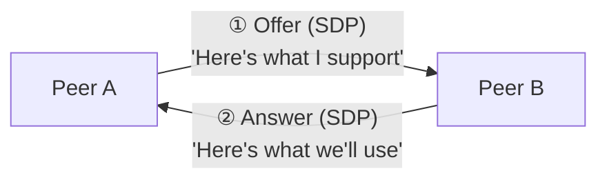

### SDP example, line by line

```text
v=0
o=- 46117317 2 IN IP4 127.0.0.1
s=-
t=0 0
m=audio 12345 RTP/AVP 111
c=IN IP4 127.0.0.1
a=rtpmap:111 opus/48000/2
a=rtcp:12346 IN IP4 127.0.0.1
a=sendrecv
a=ice-ufrag:someufrag
a=ice-pwd:somepwd
```

| Line | Meaning |
| --- | --- |
| `v=0` | SDP version (always `0`) |
| `o=- 46117317 2 IN IP4 127.0.0.1` | **Origin**: username (`-` = none), session ID, session version, network type, address type, address |
| `s=-` | **Session name** (`-` = none) |
| `t=0 0` | **Timing**: start/stop time (`0 0` = no fixed time) |
| `m=audio 12345 RTP/AVP 111` | **Media line**: an `audio` stream on port `12345`, using RTP, payload type `111` |
| `c=IN IP4 127.0.0.1` | **Connection** address for the media |
| `a=rtpmap:111 opus/48000/2` | Payload `111` = **Opus** codec, 48 kHz, 2 channels |
| `a=rtcp:12346 IN IP4 127.0.0.1` | Port used for **RTCP** (stats and control) |
| `a=sendrecv` | **Direction**: this peer both sends and receives |
| `a=ice-ufrag` / `a=ice-pwd` | **ICE credentials** used to authenticate connectivity checks |

> In real browser SDP, the transport is usually `UDP/TLS/RTP/SAVPF` (encrypted), and there is an `a=fingerprint:` line that carries the DTLS certificate fingerprint (see [Security](#9-security)).

---

## 7. Signaling: Exchanging the SDP

**Signaling** is how peers exchange SDP offers/answers and ICE candidates before they can connect directly.

- It is **not part of the WebRTC specification**. You build it yourself.
- **Any channel** that moves text between the two peers works:

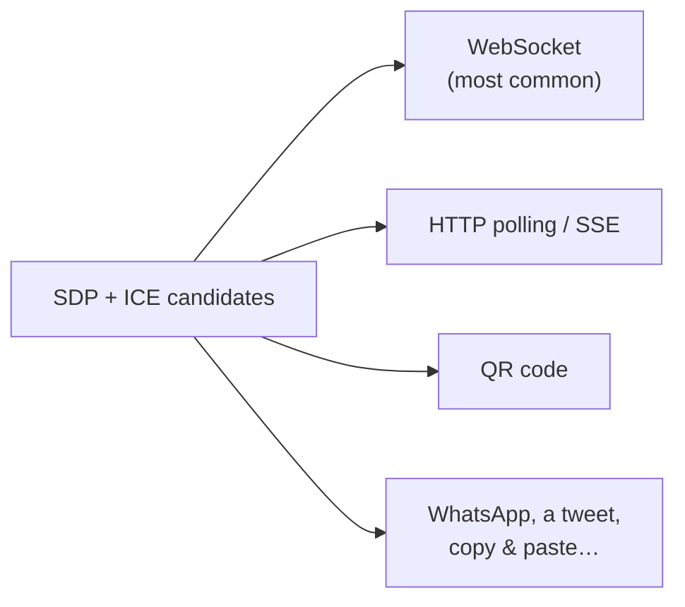

> WebSocket is the usual choice for real-time apps because it is bidirectional and low-latency.

---

## 8. Putting It All Together

### In plain words

1. **A** wants to connect to **B**.
2. **A** creates an **offer** (SDP) with its codecs and security options, gathers its ICE candidates, and sends everything to **B** via signaling.
3. **B** receives the offer, creates an **answer** (SDP), gathers its own ICE candidates, and sends them back to **A** via signaling.
4. Both peers now know each other's **candidates, codecs, and security info**.
5. ICE tests candidate pairs. STUN helps find public addresses, and TURN relays if no direct path works.
6. Once connected, **A** and **B** exchange audio, video, and data in real time.

### Full sequence

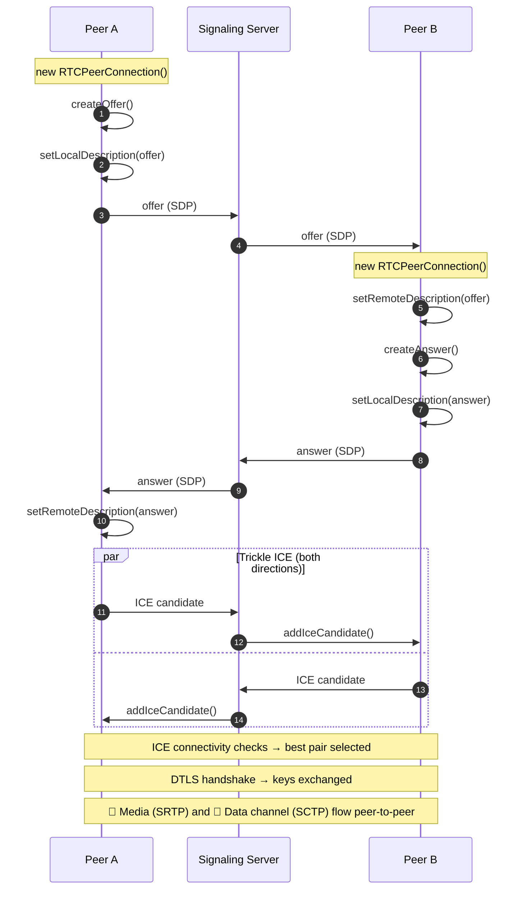

### Demo: the same flow in code

A minimal data-channel connection between two browsers. `signaling` is a placeholder for whatever channel you use (e.g. a WebSocket wrapper).

```ts
const config: RTCConfiguration = {
  iceServers: [{ urls: "stun:stun.l.google.com:19302" }],
};

// ---------- Peer A (caller) ----------
const pcA = new RTCPeerConnection(config);
const channel = pcA.createDataChannel("chat");
channel.onopen = () => channel.send("Hello from A!");

pcA.onicecandidate = (e) => e.candidate && signaling.send({ candidate: e.candidate });

const offer = await pcA.createOffer();
await pcA.setLocalDescription(offer);        // A: offer is the local description
signaling.send({ sdp: pcA.localDescription });

// ...when B's answer arrives:
await pcA.setRemoteDescription(answer);      // A: answer is the remote description

// ---------- Peer B (callee) ----------
const pcB = new RTCPeerConnection(config);
pcB.ondatachannel = (e) => {
  e.channel.onmessage = (msg) => console.log("B got:", msg.data);
};

pcB.onicecandidate = (e) => e.candidate && signaling.send({ candidate: e.candidate });

await pcB.setRemoteDescription(offer);       // B: offer is the remote description
const answer = await pcB.createAnswer();
await pcB.setLocalDescription(answer);       // B: answer is the local description
signaling.send({ sdp: pcB.localDescription });

// ---------- Both peers ----------
// ...when a remote candidate arrives:
await pc.addIceCandidate(candidate);
```

> **Remember:** *your own* SDP is always the **local** description, and *the other peer's* SDP is always the **remote** description.

---

## 9. Security

Encryption in WebRTC is **mandatory**. It cannot be turned off.

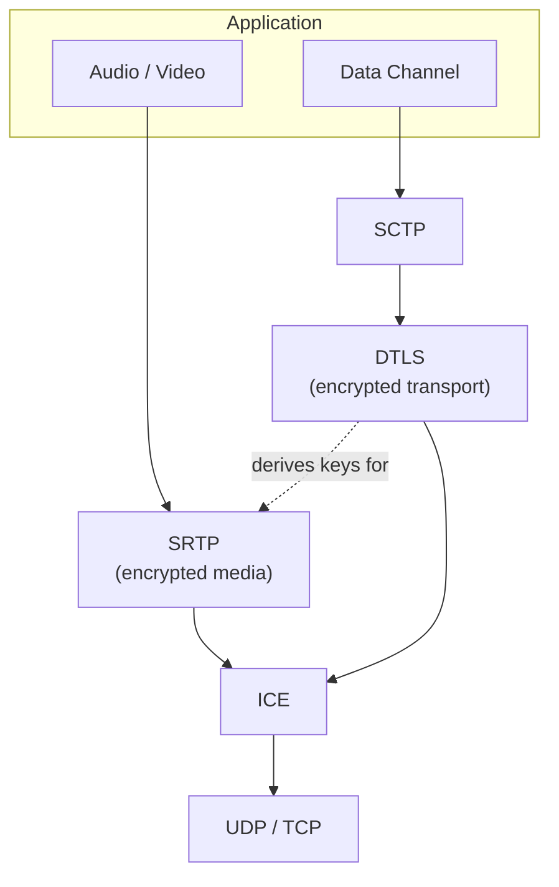

| Layer | What it protects |
| --- | --- |
| **DTLS** (Datagram TLS) | Performs the key exchange and encrypts **data channel** traffic |
| **SRTP** (Secure RTP) | Encrypts **audio and video** streams, using keys derived from the DTLS handshake |
| **SDP fingerprint** | Each peer's certificate fingerprint is sent in the SDP, so the DTLS handshake can be verified |
| **Secure context** | Browsers only allow camera/mic access (`getUserMedia`) on **HTTPS** (or `localhost`) |

> ⚠️ **Signaling security is your responsibility.** WebRTC doesn't define signaling, so use **HTTPS/WSS**. An attacker who can tamper with signaling could swap the SDP fingerprint and intercept the call.

---

## 10. Use Cases, Limitations & Alternatives

### Use cases

| | |
| --- | --- |
| 📹 Video conferencing | 📞 Voice calling |
| 📁 File sharing (P2P) | 🎮 Multiplayer gaming |
| 🖥️ Remote desktop | 📡 IoT device streaming |

### Limitations

- **Browser differences:** all modern browsers support WebRTC, but codec support and some features vary between them.
- **Network quality:** it needs a reasonably stable connection and degrades on low-bandwidth or high-latency networks.
- **Strict firewalls/NATs:** some networks block direct connections entirely, so a **TURN server** (with its bandwidth cost) is required.
- **Scaling group calls:** in a pure peer-to-peer "mesh", every participant uploads their stream to every other participant. Large calls usually route media through a media server (SFU) instead.

### Alternatives (and how they differ)

| Technology | Model | Best for |
| --- | --- | --- |
| **WebSockets** | Client ↔ server, bidirectional over a single TCP connection | Chat, live updates, and WebRTC **signaling** |
| **SIP** (Session Initiation Protocol) | Starts, maintains, and ends voice/video/messaging sessions | Telephony / VoIP systems (often **combined** with WebRTC) |
| **XMPP** (Extensible Messaging and Presence Protocol) | Federated messaging protocol | Instant messaging, presence, contact lists |

> These aren't drop-in replacements. WebRTC is the only one that streams media **directly between browsers**. The others are often used **alongside** it, especially for signaling.

---

## 11. Glossary

| Term | Full name | One-liner |
| --- | --- | --- |
| **NAT** | Network Address Translation | Router rewrites private addresses to a public one |
| **STUN** | Session Traversal Utilities for NAT | Tells a client its public `IP:port` |
| **TURN** | Traversal Using Relays around NAT | Relays traffic when a direct connection fails |
| **ICE** | Interactive Connectivity Establishment | Gathers, tests, and picks the best network path |
| **SDP** | Session Description Protocol | Text format describing media capabilities |
| **DTLS** | Datagram Transport Layer Security | TLS for UDP: key exchange and data encryption |
| **SRTP** | Secure Real-time Transport Protocol | Encrypted audio/video packets |
| **SCTP** | Stream Control Transmission Protocol | Transport used by WebRTC data channels |
| **SFU** | Selective Forwarding Unit | Media server that forwards streams in group calls |
