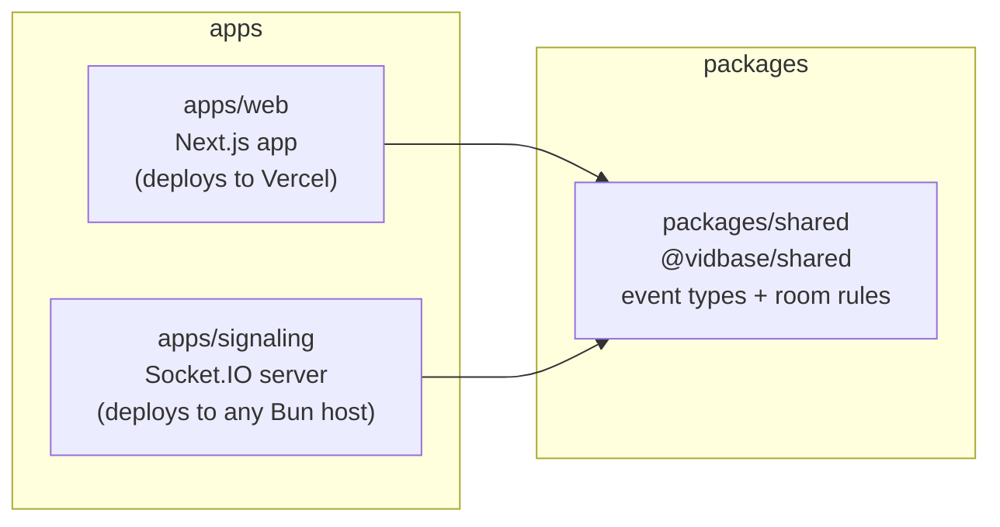
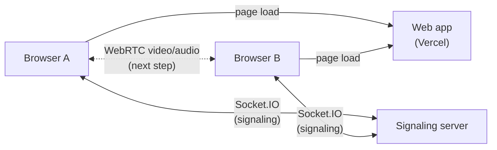
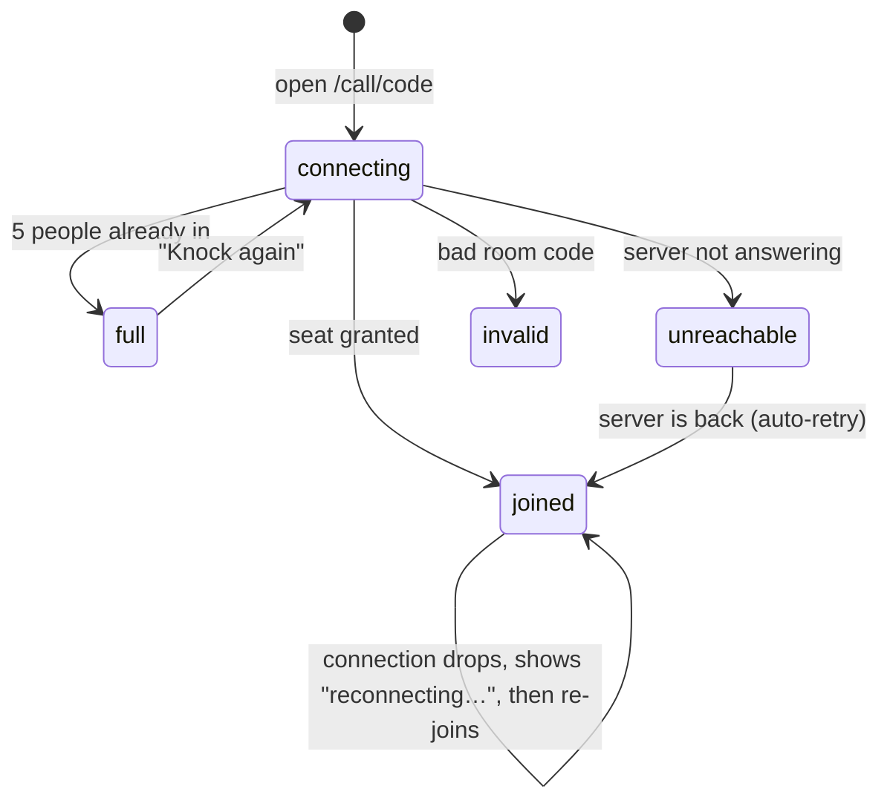
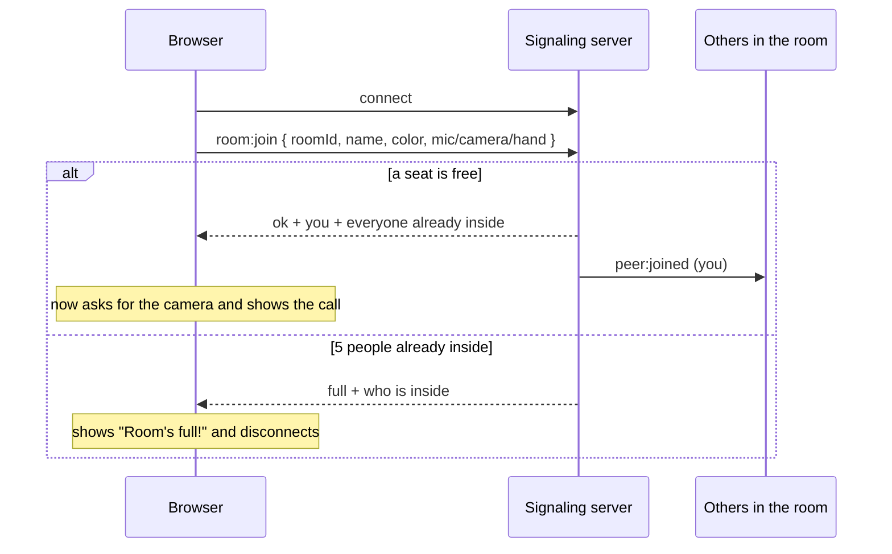
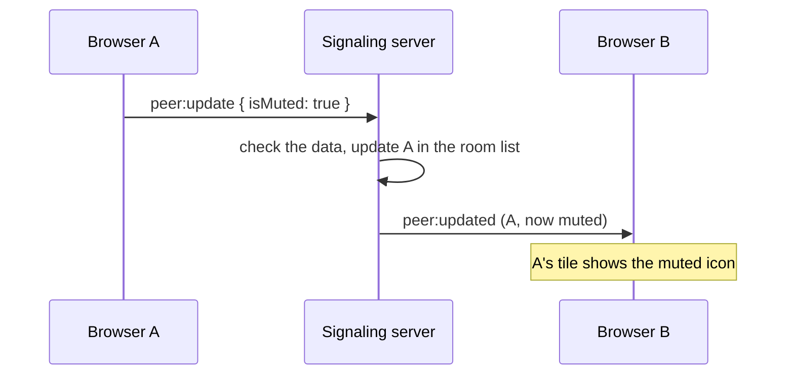
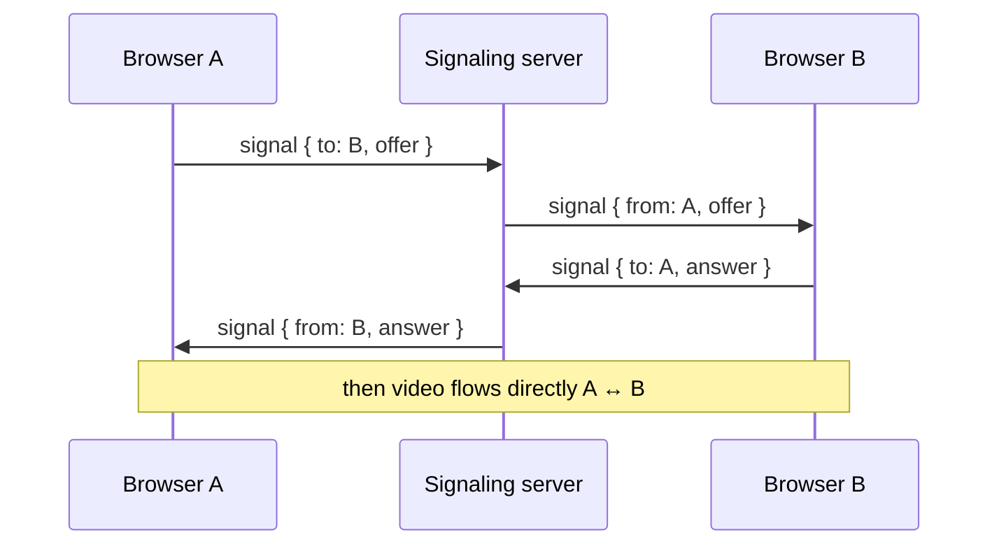
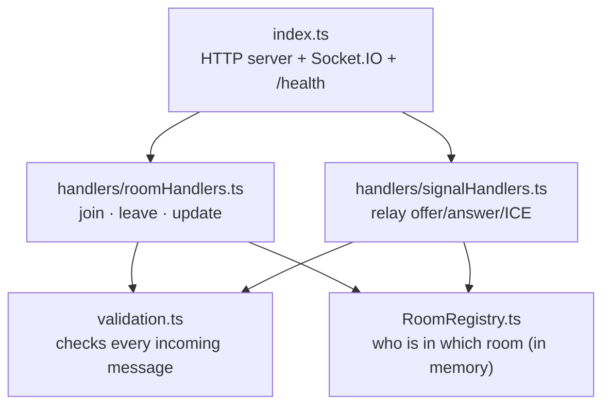
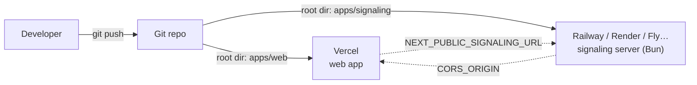

# vidbase architecture

vidbase is a video-call app. Someone creates a room, shares the room code, and up to **5 people** join the same call. This doc explains how the pieces fit together.

> **Status:** people in a room can see each other join and leave, and see each other's mic/camera/hand state live. Actual video between browsers (WebRTC) is the next step: the server can already relay the WebRTC handshake, but the browser doesn't send one yet, so other people show as avatars.

---

## 1. The repo

The code is a **monorepo**: one Git repo with several packages, run together by **Turborepo** and installed with **Bun workspaces**.



| Folder | What it is |
| --- | --- |
| `apps/web` | The website: pages, UI, the call room. |
| `apps/signaling` | A small server that tells browsers who is in which room and passes messages between them. |
| `packages/shared` | Code both apps import: the list of socket events, their data shapes, the 5-person limit, room-code rules and the color palette. |

`packages/shared` is the **contract**. If an event or its data changes, it changes there, and TypeScript flags every place on both sides that needs updating.

---

## 2. The big picture

Two kinds of traffic flow in a call:

- **Signaling** (small messages: "I joined", "I muted", WebRTC handshakes) goes through the signaling server.
- **Media** (video and audio) will go **directly between browsers** with WebRTC. It never touches our servers.



The web app and the signaling server are deployed separately. The web app finds the server through the `NEXT_PUBLIC_SIGNALING_URL` environment variable.

---

## 3. Inside the web app's call room

The call room is split into layers so each file has one job:

```mermaid
flowchart TD
  page["app/call/[roomId]/page.tsx<br/>reads the room code from the URL"] --> room["CallRoom<br/>picks which screen to show"]
  room -- "useRoomSession(roomId)" --> session["services/roomSession.ts<br/>the only code that talks to the socket"]
  session -- "calls actions" --> store["store/callStore.ts<br/>Zustand store: status, you, other peers"]
  store -- "status" --> room
  room --> call["CallSession<br/>the call itself"]
  room --> full["RoomFull"]
  room --> problem["ConnectionProblem"]
  store -- "self + peers" --> call
  call -- "shareMediaState()" --> session
  session <--> socket["lib/socket.ts<br/>one shared Socket.IO connection"]
```

- **`lib/socket.ts`** creates the single Socket.IO connection, pointed at `NEXT_PUBLIC_SIGNALING_URL`.
- **`services/roomSession.ts`** joins and leaves rooms, listens for server events and turns them into store updates. Components never touch the socket directly.
- **`store/callStore.ts`** is a [Zustand](https://zustand.docs.pmnd.rs) store. It only holds data (who's in the room, the connection status) plus simple setters.
- **`CallRoom`** shows a loader, the call, the "room full" screen or a connection problem, depending on the store's `status`.
- **`CallSession`** is the call UI. It asks for your camera **only after** the server has given you a seat, and it reports your mic/camera/hand changes through `shareMediaState()`.
- **`services/guestProfile.ts`** gives you a random name and color (like "Groovy Llama"), kept per browser tab. A second tab acts as a different person, which makes local testing easy.

### Room status



---

## 4. Joining a room



The browser sends `room:join` **every time** the socket connects, not just the first time. So if the connection drops and Socket.IO reconnects by itself, you rejoin automatically with your current mic/camera state.

## 5. Sharing mic, camera and hand



## 6. Leaving

Pressing **Leave** sends `room:leave`. Closing the tab or losing the connection counts as leaving too. Either way, everyone else gets `peer:left` and the tile disappears.

## 7. Relaying WebRTC messages (ready, not used yet)

To start a video connection, two browsers swap an **offer**, an **answer** and some **ICE candidates** (network addresses). The server just passes these along:



The server only relays a message when **both** browsers are in the same room, and it never reads the contents.

---

## 8. Inside the signaling server



- **`RoomRegistry`** keeps rooms in memory and enforces the 5-person limit. It knows nothing about sockets, so it's easy to follow.
- **`validation.ts`** treats every message from a browser as untrusted. Bad room codes, wrong types or oversized messages are rejected.
- Because rooms live in memory, run **one** server instance. Running several would need a shared store (e.g. the Socket.IO Redis adapter).

### Events

| Event | Direction | What it means |
| --- | --- | --- |
| `room:join` | browser → server | "Give me a seat." The server replies with ok/full. |
| `room:leave` | browser → server | "I'm leaving." |
| `peer:update` | browser → server | "My mic/camera/hand changed." |
| `signal` | both ways | A WebRTC offer, answer or ICE candidate for one specific peer. |
| `peer:joined` | server → browser | Someone joined your room. |
| `peer:left` | server → browser | Someone left your room. |
| `peer:updated` | server → browser | Someone's mic/camera/hand changed. |

All of these are typed in `packages/shared/src/signaling.ts`.

---

## 9. Configuration

| Variable | Used by | Meaning |
| --- | --- | --- |
| `NEXT_PUBLIC_SIGNALING_URL` | `apps/web` | Where the browser finds the signaling server. Baked in at build time, so set it before `next build`. Default `http://localhost:4000`. |
| `PORT` | `apps/signaling` | Port to listen on. Default `4000`; most hosts set it for you. |
| `CORS_ORIGIN` | `apps/signaling` | Web app address(es) allowed to connect, comma-separated. Default `http://localhost:3000`. |

## 10. Deploying



1. Deploy `apps/signaling` to a host that keeps a process running and supports Bun. Start command: `bun run start`. Set `CORS_ORIGIN` to the web app's URL.
2. Deploy `apps/web` to Vercel with root directory `apps/web`. Set `NEXT_PUBLIC_SIGNALING_URL` to the signaling server's public URL.

---

## 11. Not built yet

- **Video between browsers.** WebRTC peer connections aren't created yet, so other people show as avatars. The server-side relay is ready.
- **In-call chat** is local only and isn't sent to anyone.
- **Accounts.** Names are random per tab. There is no database on purpose: everything in a call is short-lived (see decision #15).
- **Live streaming pages** (`/studio`, `/live/...`) still use placeholder data.
