# vidbase architecture

vidbase is a video-call app. Someone creates a room, shares the room code, and up to **5 people** join the same call. This doc explains how the pieces fit together.

> **Status:** people in a room see and hear each other live over WebRTC (camera + mic only), see each other's mic/camera/hand state and who's talking, and can chat and throw emoji reactions. Every browser connects directly to every other browser (a "mesh").

---

## 1. The repo

The code is a **monorepo**: one Git repo with several packages, run together by **Turborepo** and installed with **Bun workspaces**.

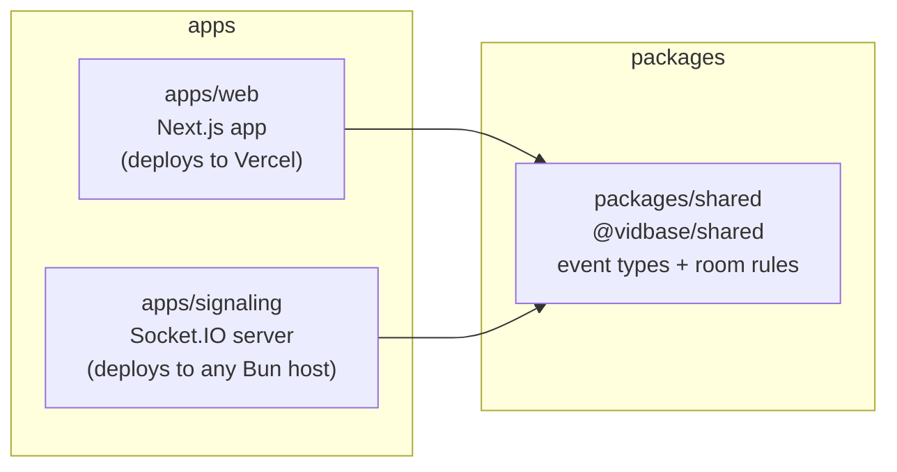

| Folder | What it is |
| --- | --- |
| `apps/web` | The website: pages, UI, the call room. |
| `apps/signaling` | A small server that tells browsers who is in which room and passes messages between them. |
| `packages/shared` | Code both apps import: the list of socket events, their data shapes, the 5-person limit, room-code rules and the color palette. |

`packages/shared` is the **contract**. If an event or its data changes, it changes there, and TypeScript flags every place on both sides that needs updating.

---

## 2. The big picture

Two kinds of traffic flow in a call:

- **Signaling** (small messages: "I joined", "I muted", WebRTC handshakes) goes through the signaling server.
- **Media** (video and audio) goes **directly between browsers** with WebRTC. It never touches our servers.

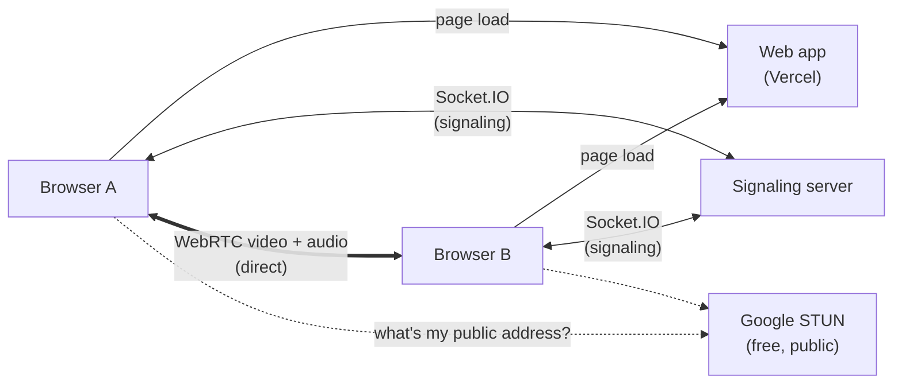

The web app and the signaling server are deployed separately. The web app finds the server through the `NEXT_PUBLIC_SIGNALING_URL` environment variable. The STUN server only helps each browser discover its public network address (see section 7).

---

## 3. Inside the web app's call room

The call room is split into layers so each file has one job:

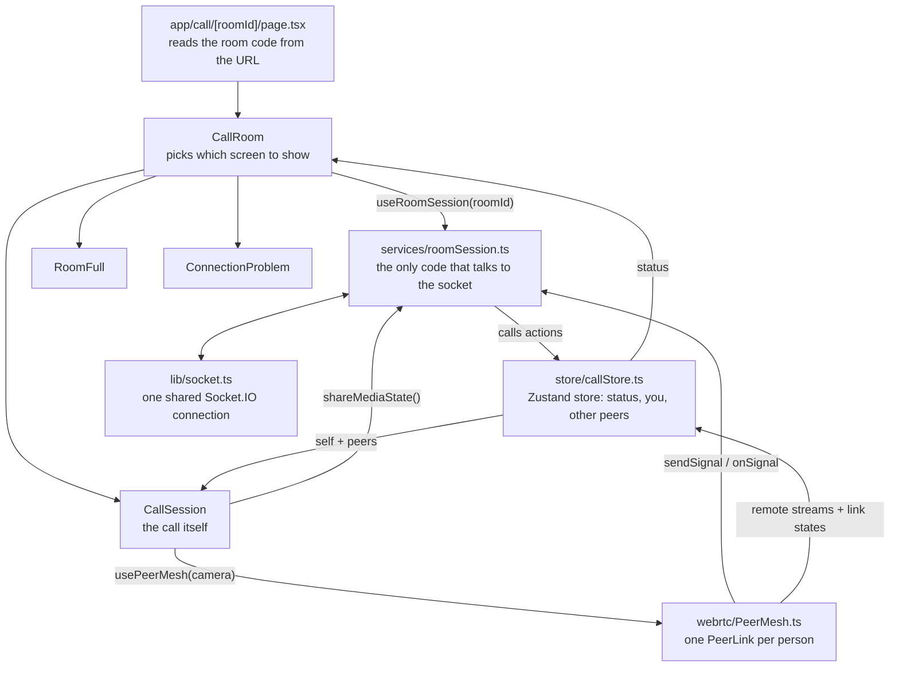

- **`lib/socket.ts`** creates the single Socket.IO connection, pointed at `NEXT_PUBLIC_SIGNALING_URL`.
- **`services/roomSession.ts`** joins and leaves rooms, listens for server events and turns them into store updates. Components never touch the socket directly.
- **`store/callStore.ts`** is a [Zustand](https://zustand.docs.pmnd.rs) store. It only holds data (who's in the room, the connection status, the chat) plus simple setters.
- **`CallRoom`** shows a loader, the call, the "room full" screen or a connection problem, depending on the store's `status`.
- **`CallSession`** is the call UI. It asks for your camera **only after** the server has given you a seat, and it reports your mic/camera/hand changes through `shareMediaState()`.
- **`VideoWall`** shows only the people who are in the room, in the order they joined. The grid changes with headcount: 1 person gets one big tile with a "waiting for others to join…" note under it, 2 sit side by side, 3–4 make two rows of two, and 5 make a row of three over a row of two.
- **`CallTopBar`** shows the room code and a **copy link** button. The code chip copies just the code (for typing into "join with code" on the home page). The link button copies `<site>/call/<code>`; opening that link drops a friend straight into the call.
- **`ControlDock`** (mic, camera, hand, reactions, chat, people, leave) is a vertical bar on the right edge on tablets and desktops, and a row along the bottom on phones. The chat button gets a red dot when messages arrive while the chat is closed.
- **`hooks/usePeerMesh.ts`** runs WebRTC while you're in the call: it creates the mesh, feeds it your camera, and connects it to the socket and the store (section 7).
- **`hooks/useSpeakingPeers.ts`** measures how loud each person's audio is and reports who's talking, which lights up their tile (section 7.6).
- **`RemoteAudio`** plays everyone's voice through hidden `<audio>` elements (section 7).
- **`services/guestProfile.ts`** gives you a random name and color (like "Groovy Llama"), kept per browser tab. A second tab acts as a different person, which makes local testing easy.

### Room status

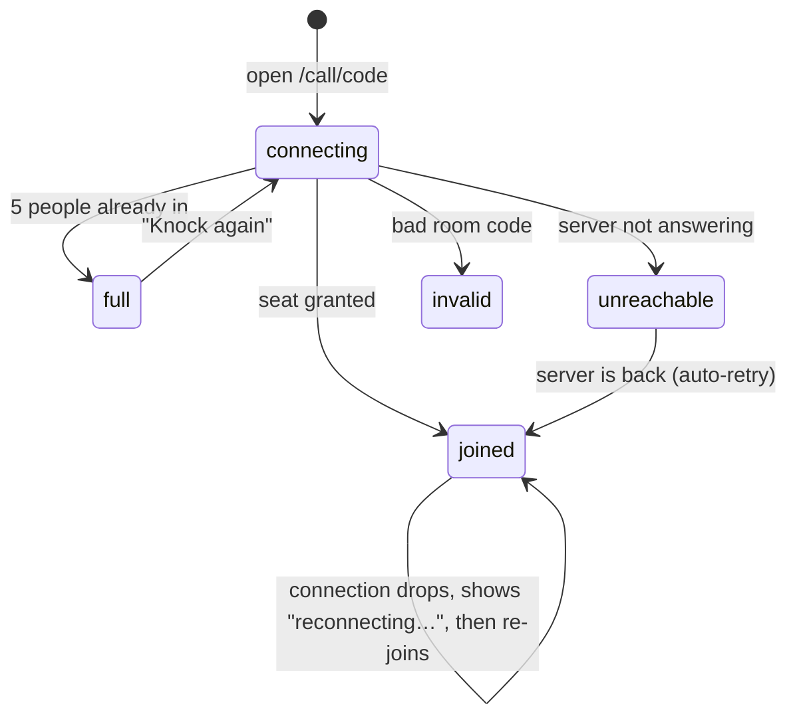

---

## 4. Joining a room

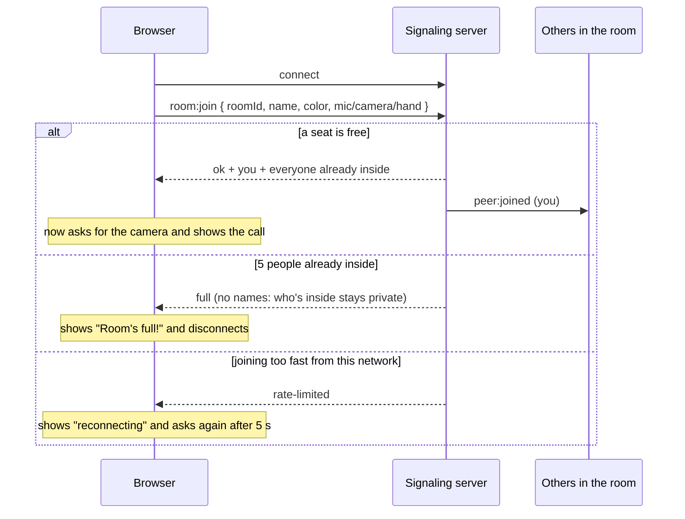

**Room codes** look like `wobbly-mango-k7f3q9`: two words plus 6 random characters (no `0`/`o`/`1`/`l`, so they're easy to read out). The code is the only key to a room, so it's made with the browser's secure random generator and has about 900 billion possibilities. Together with the join rate limit (section 8), guessing one isn't practical.

The browser sends `room:join` **every time** the socket connects, not just the first time. So if the connection drops and Socket.IO reconnects by itself, you rejoin automatically with your current mic/camera state.

## 5. Sharing mic, camera and hand

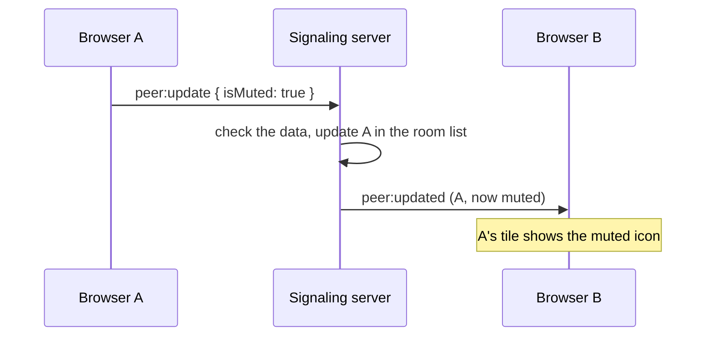

### Chat and reactions

Chat messages and emoji reactions go through the signaling server too (not over WebRTC). You see your own message or emoji right away; the server passes it on to everyone else.

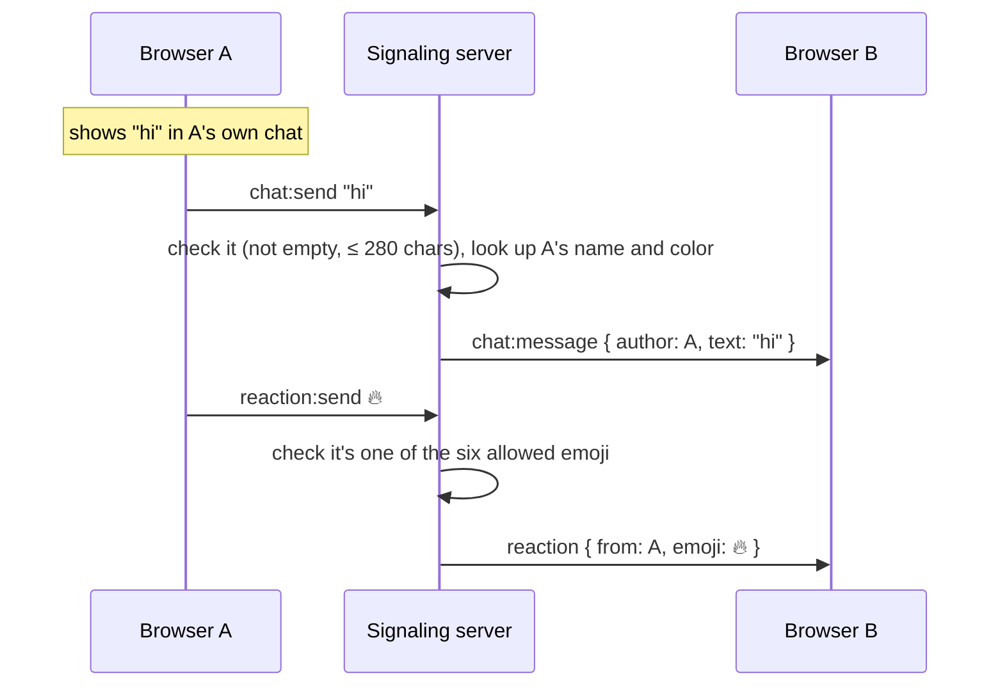

- The server fills in the author itself, so nobody can send messages under someone else's name.
- Nothing is stored on the server. If you join late you only see messages sent after you arrived.

## 6. Leaving

Pressing **Leave** sends `room:leave`. Closing the tab or losing the connection counts as leaving too. Either way, everyone else gets `peer:left` and the tile disappears.

## 7. Video between browsers (WebRTC)

### 7.1 The mesh

Every person has one direct WebRTC connection to every other person. With 5 people that's 4 connections each (10 in total). Each browser uploads its video once **per person**, which is fine for small calls but is why the room is capped. Big apps send video to a media server (an "SFU") instead, which forwards it.

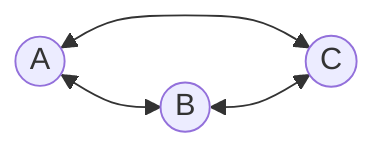

The code is split in two:

- **`webrtc/PeerLink.ts`**: one `RTCPeerConnection` to **one** person. It runs the handshake, sends your tracks and collects theirs.
- **`webrtc/PeerMesh.ts`**: a map of `PeerLink`s, one per person. It routes each incoming message to the right link and passes your camera to all of them. It doesn't know about sockets or React.

### 7.2 The handshake

To connect, two browsers swap three kinds of messages through the signaling server:

1. **Offer**: an SDP text describing what I'll send and receive (audio + video, codecs, encryption keys).
2. **Answer**: the other side's matching SDP.
3. **ICE candidates**: network addresses where I might be reachable (my local address, and my public address learned from the STUN server).

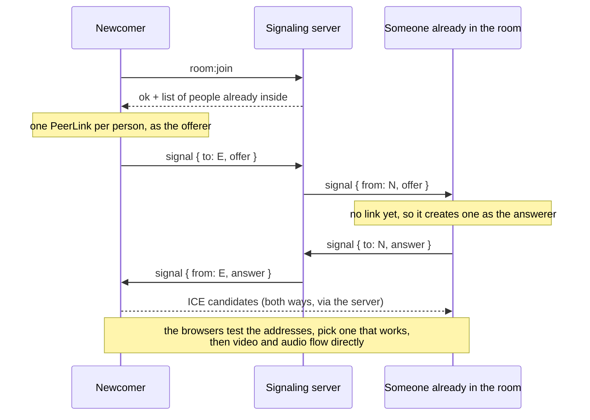

The server only relays a `signal` when **both** browsers are in the same room, and it never reads the contents.

### 7.3 Who makes the offer

**The person who just joined offers to everyone already in the room. The others only ever answer.** If both sides of a pair could offer, they might do it at the same moment ("glare") and need extra back-off logic (the "perfect negotiation" pattern). Making only one side offer avoids that problem entirely.

### 7.4 Fixed lanes + `replaceTrack`

The offerer creates exactly two **transceivers** ("lanes"), one for audio and one for video, each sending and receiving. The answerer gets the same lanes from the offer and puts its own tracks in them.

Your camera often becomes ready **after** the connection starts (the browser is still asking for permission). That doesn't need a new offer: we call `sender.replaceTrack(newTrack)` to swap what plays in a lane. Muting doesn't touch the connection at all: the track is just disabled (`track.enabled = false`), so it sends silence or black frames, and the `peer:update` event tells everyone to show the mute icon or avatar.

### 7.5 Doing things in order

WebRTC calls are asynchronous. If an ICE candidate is applied before the offer has finished processing, the browser throws an error. So each `PeerLink` applies incoming messages **one at a time**, in arrival order, using a promise chain.

### 7.6 Hearing people

Every `<video>` element is muted, so your own mic never echoes back and tiles can swap to an avatar freely. Other people's sound plays through **hidden `<audio>` elements** in `RemoteAudio`, one per person, so you still hear someone whose camera is off.

**Who's talking** is worked out in each browser: `useSpeakingPeers` feeds every stream (yours and everyone else's) into a Web Audio `AnalyserNode` and checks the loudness 10 times a second. Above a small threshold, that person's tile gets a green ring and moving bars; the ring stays on for 0.4 s after they go quiet so it doesn't flicker between words. A muted mic sends silence, so it never lights up.

Browsers block sound until you've interacted with the page. If playback is blocked (e.g. you opened a shared link directly), a **"Tap to hear everyone"** button appears, and one click starts all audio.

### 7.7 When things go wrong

| Situation | What happens |
| --- | --- |
| Connection still setting up | The tile shows "connecting…". |
| Network blip | The tile shows "reconnecting…" until WebRTC recovers by itself. |
| Connection failed | The offerer calls `restartIce()`, which sends a fresh offer with new network candidates. |
| Someone leaves | Their link is closed and their stream and audio removed. |
| Your socket reconnects | The server gives you a new id, so everyone treats you as a newcomer. `usePeerMesh` throws away the old mesh and offers to everyone again. |

### 7.8 STUN and TURN

Most devices sit behind a router (NAT) and only know their private address. A **STUN** server tells a browser its public address so the other side can reach it. We use Google's free public STUN servers (`webrtc/iceServers.ts`).

On some networks (strict firewalls, "symmetric" NATs) no direct path exists at all. Then a **TURN** server is needed: it relays the video itself, which costs bandwidth, so there's no free public one. vidbase works without it on most home networks. To add one, set the `NEXT_PUBLIC_TURN_*` variables (section 9).

---

## 8. Inside the signaling server

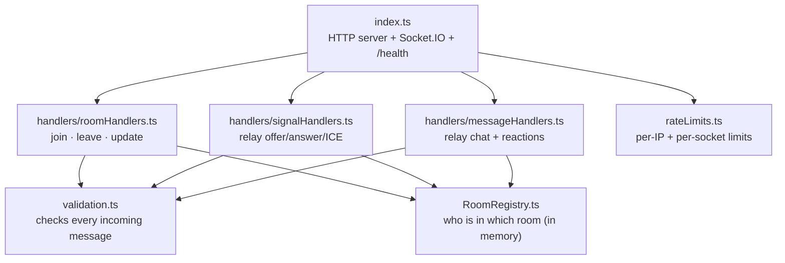

- **`RoomRegistry`** keeps rooms in memory and enforces the 5-person limit. It knows nothing about sockets, so it's easy to follow.
- **`validation.ts`** treats every message from a browser as untrusted. Bad room codes, wrong types or oversized messages are rejected.
- **`rateLimits.ts`** stops any one client from flooding the server or a room (see below).
- Because rooms live in memory, run **one** server instance. Running several would need a shared store (e.g. the Socket.IO Redis adapter).

### Rate limits

Every limit is a **token bucket**: you start with a few tokens (the burst), each action uses one, and they slowly come back. Short bursts are fine; a steady flood is not.

| What | Counted per | Burst | Refill |
| --- | --- | --- | --- |
| Open connections | IP | 20 at once | n/a |
| New connections | IP | 20 | 1 every 3 s |
| `room:join` | IP | 10 | 1 every 2 s |
| `chat:send` | socket | 5 | 1 per s |
| `reaction:send` | socket | 10 | 5 per s |
| `peer:update` | socket | 10 | 5 per s |
| `signal` | socket | 200 | 50 per s |

- Connections and joins are counted **per IP**, because reconnecting gives you a new socket and would otherwise reset the count. Messages are counted **per socket**; that's enough since every socket has to join through the IP limit first.
- Over the limit, messages are dropped silently. A refused connection or join makes the browser show "reconnecting" and try again after 5 seconds.
- **Finding the real IP:** in production every connection comes from `cloudflared` on the same machine, so the server reads the `cf-connecting-ip` header that Cloudflare adds. It only trusts that header on connections from `localhost`, so nobody connecting directly can fake it.
- The browser also keeps at most 30 floating emoji on screen.

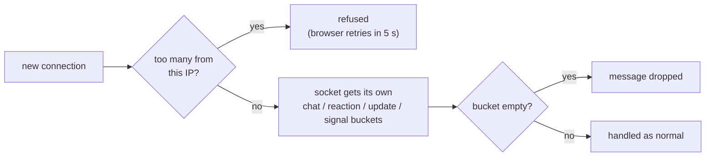

### Events

| Event | Direction | What it means |
| --- | --- | --- |
| `room:join` | browser → server | "Give me a seat." The server replies ok, full or rate-limited. |
| `room:leave` | browser → server | "I'm leaving." |
| `peer:update` | browser → server | "My mic/camera/hand changed." |
| `signal` | both ways | A WebRTC offer, answer or ICE candidate for one specific peer. |
| `peer:joined` | server → browser | Someone joined your room. |
| `peer:left` | server → browser | Someone left your room. |
| `peer:updated` | server → browser | Someone's mic/camera/hand changed. |
| `chat:send` | browser → server | "Send this chat message to the room." |
| `chat:message` | server → browser | A chat message from someone else, with their name and color. |
| `reaction:send` | browser → server | "I threw this emoji." |
| `reaction` | server → browser | Someone else threw an emoji. |

All of these are typed in `packages/shared/src/signaling.ts`.

---

## 9. Configuration

| Variable | Used by | Meaning |
| --- | --- | --- |
| `NEXT_PUBLIC_SIGNALING_URL` | `apps/web` | Where the browser finds the signaling server. Baked in at build time, so set it before `next build`. Default `http://localhost:4000`. |
| `NEXT_PUBLIC_TURN_URL`, `NEXT_PUBLIC_TURN_USERNAME`, `NEXT_PUBLIC_TURN_CREDENTIAL` | `apps/web` | Optional TURN relay for networks where a direct connection is impossible. Empty means STUN only. |
| `PORT` | `apps/signaling` | Port to listen on. Default `4000`; most hosts set it for you. |
| `CORS_ORIGIN` | `apps/signaling` | Web app address(es) allowed to connect, comma-separated. Default `http://localhost:3000`. |

## 10. Deploying

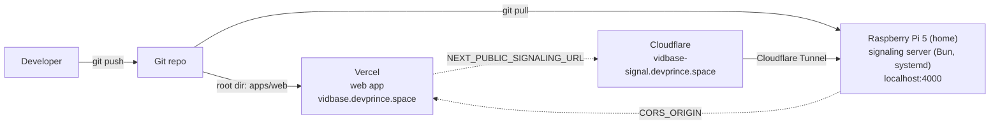

The signaling server runs on a Raspberry Pi at home. The Pi has no open router ports: a small program called `cloudflared` keeps an outgoing connection to Cloudflare open. Browsers connect to `https://vidbase-signal.devprince.space`; Cloudflare handles HTTPS there and passes the traffic (including WebSockets) down that connection to `localhost:4000` on the Pi.

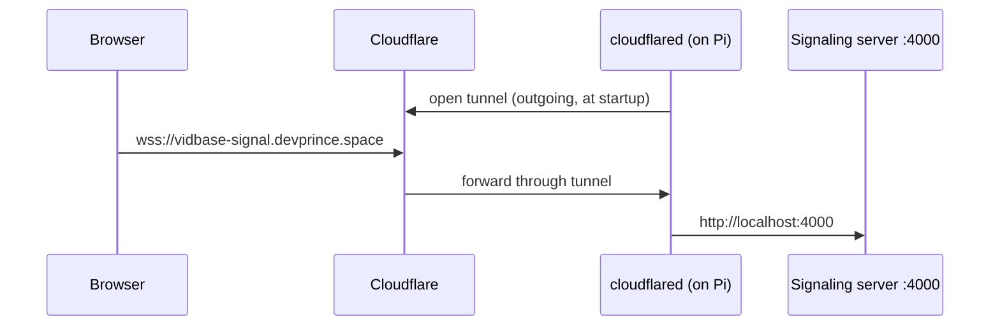

1. **Signaling server (Pi):** clone the repo, `bun install --production --filter '@vidbase/signaling'`, set `CORS_ORIGIN` in `apps/signaling/.env` to the web app's URL, and run `bun src/index.ts` from `apps/signaling` as a systemd service so it restarts on crash or reboot.
2. **Public address:** a Cloudflare Tunnel (also a systemd service) maps `vidbase-signal.devprince.space` to `http://localhost:4000`.
3. **Web app:** deploy `apps/web` to Vercel with root directory `apps/web`. Set `NEXT_PUBLIC_SIGNALING_URL=https://vidbase-signal.devprince.space`, then redeploy (it's baked in at build time).
4. **Web app domain:** `vidbase.devprince.space` is added in Vercel (Settings → Domains) and points to Vercel with a CNAME record in Cloudflare set to "DNS only" (grey cloud), so Vercel issues the HTTPS certificate itself. `CORS_ORIGIN` on the Pi lists this domain (plus the `*.vercel.app` URL).

The signaling server is not tied to the Pi: any host that keeps a Bun process running works the same way.

---

## 11. Not built yet

- **TURN by default.** Calls between some strict networks can fail until a TURN server is configured.
- **Chat history.** Chat isn't stored, so people who join late don't see earlier messages.
- **Accounts.** Names are random per tab. There is no database on purpose: everything in a call is short-lived (see decision #15).
- **Live streaming pages** (`/studio`, `/live/...`) still use placeholder data.
